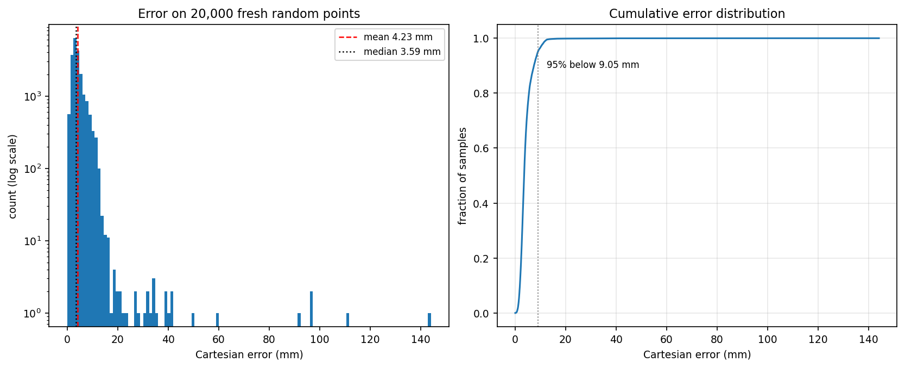
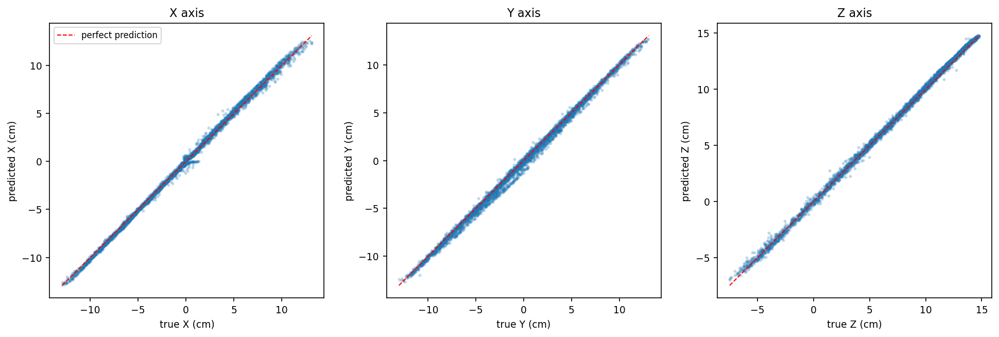
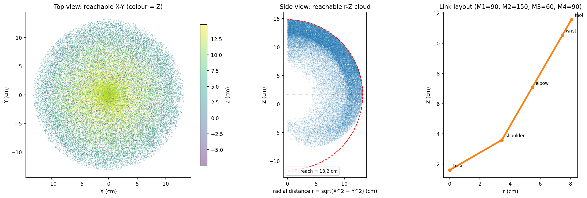

# Neural Network based Inverse Kinematics for a 4-DOF Robot Arm

A small PyTorch project that learns the **inverse kinematics** of my 4-DOF robot arm
directly from data: give it a target tool position **(X, Y, Z) in centimetres**, and
it predicts the four motor angles **(M1, M2, M3, M4) in degrees** in a single forward
pass. The trained model is then used to stream motor commands to the arm's
ESP32/Arduino over serial.

I built this as a hands-on project to understand whether a plain multilayer
perceptron can replace a hand-derived analytic IK solution for a redundant arm, how
to design a loss that respects the robot's geometry, and how to take the model from a
notebook-style experiment all the way to hardware.

```
   target point (X, Y, Z)  ──►  neural network  ──►  M1, M2, M3, M4  ──►  serial  ──►  ESP32
```

---

## Results

Measured on **20,000 brand-new random joint configurations** (never seen during
training), comparing the tool position of the network's predicted angles with the
true position:

| Metric | Value |
| --- | --- |
| Mean Cartesian error | **4.23 mm** |
| Median Cartesian error | 3.59 mm |
| 95th percentile | 9.05 mm |
| Worst case | 144.02 mm |

95% of all targets are within about **9 mm**, and the median is under 4 mm. The
worst-case points are not a bug: many different joint configurations put the tool at
exactly the same point, so the network learns the average of several valid solutions.
At a few ambiguous points those solutions are far apart. I discuss this in
[Notes on accuracy](#notes-on-accuracy).





---

## The robot

The arm has a yaw base and three pitch links, with a gripper offset at the end. All
geometry comes from my existing `arm3d.html` visualiser, so the learned model and the
3D preview agree.

| Parameter | Value | Meaning |
| --- | --- | --- |
| `L1` | 4.0 cm | shoulder → elbow |
| `L2` | 4.0 cm | elbow → wrist |
| `L3` | 4.0 cm | wrist link |
| `GRIP` | 1.2 cm | gripper length beyond link 3 |
| `L3EFF` | 5.2 cm | wrist → tool centre point (`L3 + GRIP`) |
| `H0` | 1.6 cm | shoulder height above the base plane |
| `REACH` | 13.2 cm | maximum radial reach |
| joint range | 0–180° | all four motors |

### Forward kinematics

With motor angles in degrees, the forward kinematics (the same equations as
`fk()` in `arm3d.html`) are:

$$
\begin{aligned}
yaw &= M_1 - 90^\circ \\
d_1 &= 180^\circ - M_2 \\
d_2 &= d_1 + (90^\circ - M_3) \\
d_3 &= d_2 + (90^\circ - M_4)
\end{aligned}
$$

$$
\begin{aligned}
r &= L_1 \cos d_1 + L_2 \cos d_2 + L_{3,\text{eff}} \cos d_3 \\
x &= r \cos(yaw) \\
y &= r \sin(yaw) \\
z &= H_0 + L_1 \sin d_1 + L_2 \sin d_2 + L_{3,\text{eff}} \sin d_3
\end{aligned}
$$

This lives in `dataset.py` as `forward_kinematics_xyz()`, fully vectorised so I can
evaluate a million configurations in one call.



*Left: top view of the reachable volume, coloured by height. Middle: side view of the
same data as radial distance vs height, with the 13.2 cm reach envelope. Right: the
link layout at one configuration.*

---

## Dataset

`generate_data.py` draws 1,000,000 uniform random configurations
$M_1 \dots M_4 \sim \mathcal{U}[0, 180]^\circ$, computes their tool positions with the
exact FK above, and saves both tensors to `ik_dataset.pt`:

```python
angles = torch.rand(NUM_SAMPLES, 4) * 180.0   # (N, 4) degrees
xyz = forward_kinematics_xyz(angles)          # (N, 3) centimetres
torch.save({"inputs": xyz, "targets": angles}, "ik_dataset.pt")
```

Generation takes a few seconds and produces a file of about 28 MB. The positions span
roughly `X ∈ [-13.1, 12.9]`, `Y ∈ [-12.9, 13.1]`, `Z ∈ [-7.5, 14.8]` cm.

**Why synthetic data?** The FK is exact and cheap, so I could generate far more
supervised pairs than I could ever record on the real arm. The trade-off is that the
dataset follows the model's geometry exactly — any error between the model and the
physical robot (servo offsets, link tolerances) is not represented. That is the first
thing I would fix for a real deployment.

In `dataset.py`, `RobotIKDataset` normalises the inputs to zero mean / unit variance
per axis, and the outputs to $[0, 1]$ by dividing by 180°. The normalisation statistics
are stored in the checkpoint so inference uses exactly the same scaling as training.

---

## Network

A small fully-connected network, deliberately lightweight enough to eventually run on
a microcontroller:

| Layer | Size | Activation |
| --- | --- | --- |
| input | 3 (X, Y, Z) | — |
| linear 1 | 256 | SiLU |
| linear 2 | 512 | SiLU |
| linear 3 | 512 | SiLU |
| linear 4 | 256 | SiLU |
| output | 4 (M1…M4) | Sigmoid |

Total: **527,620 parameters**. The final Sigmoid is a natural choice here because every
motor is limited to 0–180°: the network can never predict an out-of-range angle, so no
output clamping is needed.

### Hybrid loss

Plain MSE on joint angles is ambiguous for a redundant arm: several very different
joint vectors map to the same position, and nothing in the loss tells the network that
two of them are equally valid. I added a differentiable Cartesian term that penalises
where the *predicted* pose actually ends up:

$$
\mathcal{L} = \mathrm{MSE}(\hat{\theta}, \theta)
\;+\; 0.05 \cdot \bigl\lVert \mathrm{FK}(180^\circ \cdot \hat{\theta}) - X_{\text{target}} \bigr\rVert^2
$$

The FK is fully differentiable in PyTorch, so gradients flow straight through the
geometry. The weight `FK_WEIGHT = 0.05` keeps the joint-space term dominant while
encouraging the predicted pose to be physically sensible.

---

## Training

| Setting | Value |
| --- | --- |
| Optimiser | AdamW, weight decay 1e-2 |
| Learning rate | 1e-3 |
| Batch size | 256 |
| Epochs | 25 |
| Seed | 42 (reproducible) |
| Held-out check | 10,000 samples (best epoch kept) |

`train.py` trains on 990,000 samples and holds back the last 10,000 **only** to measure
the Cartesian error after each epoch; the weights with the lowest held-out error are
saved to `neural_ik_model.pth`. There is no early stopping — all 25 epochs always run.
Because the random seed is fixed, running `python train.py` twice gives exactly the
same weights.

On CPU a full run takes roughly 15–30 minutes; with a CUDA GPU it is a few minutes.
The checkpoint contains the weights plus the input normalisation statistics, so
inference scripts don't need the dataset.

**About the included checkpoint:** it came from a 25-epoch run (best epoch 22, batch
256, lr 1e-3) with an earlier 90/10 split version of the script. Current `train.py`
uses the 990k/10k split described above, so a fresh run may land on slightly different
numbers.

---

## Evaluation

`evaluate.py` checks the model honestly:

1. Draw 20,000 **new** random joint configurations.
2. Compute their true tool positions with the exact FK.
3. Feed only those positions to the network.
4. Compare the position produced by the predicted angles with the truth, in millimetres.

No training data is involved, so this is a genuine test-set measurement. Running it
twice gives slightly different numbers because the test points are redrawn each time.

---

## Repository structure

```
.
├── generate_data.py     # step 1: build ik_dataset.pt from random joint angles
├── dataset.py           # robot constants, FK, RobotIKDataset + normalisation
├── train.py             # NeuralIKNet, hybrid loss, training loop, checkpoint saving
├── evaluate.py          # fresh-sample accuracy check (mean / max error)
├── stream_serial.py     # real-time inference -> serial commands for the MCU
├── make_figures.py      # regenerates every diagram used in this README
├── README.md            # this file
├── readme.txt           # short plain-text quick-start version
└── figures/             # diagrams produced by make_figures.py (committed)
    ├── workspace.png
    ├── accuracy.png
    ├── pred_vs_true.png
    └── training_curve.png   # only after a run that records history

Generated at runtime (not committed):
    ik_dataset.pt         # 1,000,000 samples, ~28 MB
    neural_ik_model.pth   # trained weights + normalisation stats, ~2 MB
```

### What each file does

| File | Description |
| --- | --- |
| `generate_data.py` | Samples 1M uniform joint configurations in [0°, 180°], computes the exact tool position with FK, saves `{inputs: XYZ, targets: angles}` to `ik_dataset.pt`. Settings `NUM_SAMPLES`, `SEED`. |
| `dataset.py` | Single source of truth for the robot geometry. Contains the link constants, `forward_kinematics_xyz()` (vectorised), and `RobotIKDataset`, which normalises XYZ to mean 0 / std 1 and angles to [0, 1]. |
| `train.py` | Defines `NeuralIKNet`, the hybrid loss, and the training loop. Uses `SEED`, `EPOCHS`, `BATCH_SIZE`, `LEARNING_RATE`, `FK_WEIGHT`. Saves the best held-out epoch and its normalisation stats. Also provides `load_model()`. |
| `evaluate.py` | Loads the checkpoint, predicts on 20,000 fresh random targets and prints mean/max Cartesian error in mm. |
| `stream_serial.py` | Loads the model, reads target X Y Z from the keyboard, and writes `M1 x; M2 x; M3 x; M4 x;` lines to the serial port. Set `PORT`, `BAUD_RATE`, and `DRY_RUN` at the top. |
| `make_figures.py` | Produces the workspace, accuracy and prediction plots (and the training curve if the checkpoint has history). Uses the same dataset and model. |
| `readme.txt` | Very short plain-text instructions, useful if the Markdown is inconvenient. |
| `figures/` | PNG diagrams embedded in this README. Regenerate with `python make_figures.py`. |

---

## Quick start

```bash
# 1. install
pip install torch matplotlib pyserial

# 2. generate the dataset (a few seconds, ~28 MB)
python generate_data.py

# 3. train (25 epochs; CPU: roughly 15-30 min)
python train.py

# 4. measure accuracy on fresh points
python evaluate.py

# 5. (optional) talk to the arm - edit PORT first
python stream_serial.py
```

All settings are plain constants at the top of each file — there is deliberately no
`argparse` layer, because I wanted the scripts to be easy to read and edit.

### Streaming to the hardware

`stream_serial.py` opens the serial port at 115200 baud, waits 2 seconds for the
microcontroller to reset, then prompts for targets:

```
X Y Z> 8 0 6
M1 86.5; M2 92.8; M3 142.6; M4 150.0;
```

On the ESP32/Arduino side, the firmware only needs to split the line on `;`, read the
number after each `M`, and move the matching servo. Angles are already clamped to
0–180° by the host. I recommend starting with `DRY_RUN = True` to confirm the model
outputs look sane before connecting real hardware.

---

## Generating the figures

```bash
python make_figures.py
```

| Figure | What it shows |
| --- | --- |
| `figures/workspace.png` | Reachable workspace from 40,000 dataset points: top view, radial side view with the reach envelope, and the link layout for one pose. |
| `figures/accuracy.png` | Histogram (log scale) and CDF of the Cartesian error on 20,000 fresh points, with mean / median / 95th percentile marked. |
| `figures/pred_vs_true.png` | Predicted vs true X, Y and Z; the tighter the diagonal, the better. |
| `figures/training_curve.png` | Loss and held-out error per epoch — only produced if the checkpoint contains a training history, so retrain once with the current `train.py` to get it. |

The plotting code is intentionally separate from the pipeline so training does not
depend on matplotlib.

---

## Notes on accuracy

The mapping from four joint angles to a 3D position is **many-to-one**: the arm is
redundant, so two very different poses can put the tool at the same point. A network
trained with a plain regression loss can only learn the conditional average of those
solutions. That's why:

- the mean error is small (a few millimetres) rather than zero,
- a small fraction of points has a large error (the worst case here is 144 mm): at
  those points the valid solutions are far apart, and the average lands between them.

The FK term in the loss helps the network pick physically sensible poses, but it cannot
remove the ambiguity itself. This is a property of the arm, not of the training code.

## Limitations and what I would do next

- **Ambiguous poses.** Predict a branch label (elbow-up / elbow-down) as a fourth
  input, or predict a mixture/distribution instead of a single answer.
- **Sim-to-real gap.** The dataset is generated from the ideal FK. Servo offsets and
  link-length tolerances would shift the real workspace; calibrating those and
  regenerating the data is the next step.
- **No orientation target.** Only the tool position is supervised. Adding a wrist
  pitch target would make the output more like a full pose.
- **Precision tasks.** For tasks needing sub-millimetre accuracy, the analytic IK is
  still the better tool; the network is a fast, smooth approximation, not an exact
  solver.
- **On-device deployment.** The ONNX export and embedded inference were removed to
  keep this repo small; a 527k-parameter MLP is a good candidate for quantisation.

## What I learned

- A small MLP can learn inverse kinematics surprisingly well (millimetre-level mean
  error) when it is given a geometry-aware loss, even for a redundant arm.
- Normalisation matters: without per-axis scaling the network trains much more slowly.
- The hard part is not the network, it is the ambiguity of the inverse problem — the
  data, not the architecture, determines the achievable accuracy.
- Reproducibility (fixed seed, saved normalisation statistics) is worth the two extra
  lines of code; it made debugging the hardware pipeline much easier.
